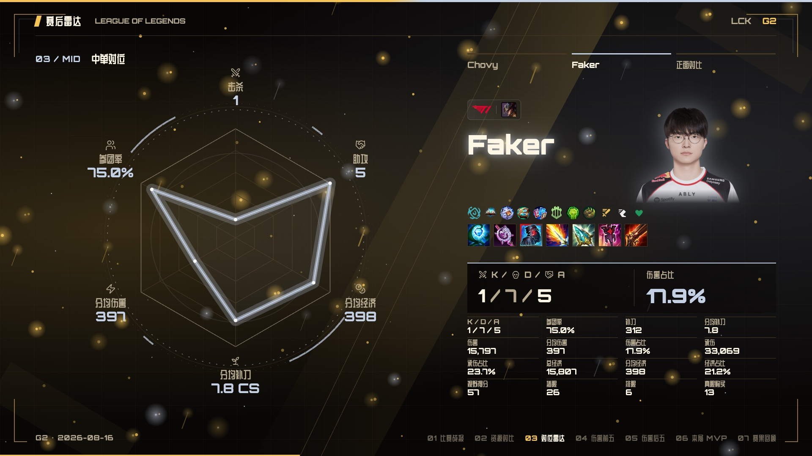
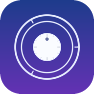
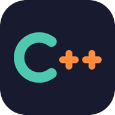
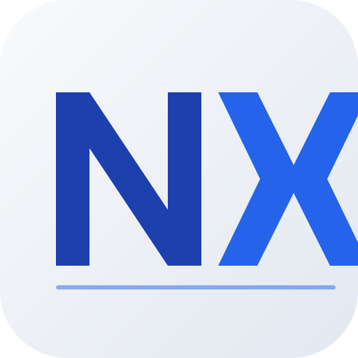
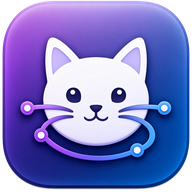

<p align="right">
  <b>English</b> | <a href="README.zh.md">中文</a>
</p>

<h1 align="center">
  <a href="https://github.com/Cass-ette">
    
  </a>
</h1>

<p align="center">
  
</p>

<p align="center">
  <a href="https://github.com/Cass-ette">
    
  </a>
</p>

---

###  About Me

```yaml
name: Cass-ette
location: China
interests:
  - Coding
  - Open Source
  - Building Cool Stuff
hobbies:
  - Turning coffee into code
  - Debugging at 3 AM
  - Making things work
  - Playing League of Legends
current_focus: Creating awesome projects
```

<br clear="both">

###  Tech Stack

| Direction | Main stack | Also used |
| :--- | :--- | :--- |
|  **Backend & scripting** | <picture><source media="(prefers-color-scheme: dark)" srcset="https://skillicons.dev/icons?i=go%2Cpython&theme=dark" /><source media="(prefers-color-scheme: light)" srcset="https://skillicons.dev/icons?i=go%2Cpython&theme=light" /></picture><br />Go · Python | <picture><source media="(prefers-color-scheme: dark)" srcset="https://skillicons.dev/icons?i=java%2Cnodejs%2Cflask&theme=dark" /><source media="(prefers-color-scheme: light)" srcset="https://skillicons.dev/icons?i=java%2Cnodejs%2Cflask&theme=light" /></picture><br />Java · Node.js · Flask |
|  **Frontend & Web** | <picture><source media="(prefers-color-scheme: dark)" srcset="https://skillicons.dev/icons?i=ts%2Creact&theme=dark" /><source media="(prefers-color-scheme: light)" srcset="https://skillicons.dev/icons?i=ts%2Creact&theme=light" /></picture><br />TypeScript · React | <picture><source media="(prefers-color-scheme: dark)" srcset="https://skillicons.dev/icons?i=vue%2Ctailwind%2Cjs%2Chtml%2Ccss&theme=dark" /><source media="(prefers-color-scheme: light)" srcset="https://skillicons.dev/icons?i=vue%2Ctailwind%2Cjs%2Chtml%2Ccss&theme=light" /></picture><br />Vue · Tailwind CSS · JavaScript · HTML / CSS |
|  **Apple & native apps** | <picture><source media="(prefers-color-scheme: dark)" srcset="https://skillicons.dev/icons?i=swift%2Ccpp&theme=dark" /><source media="(prefers-color-scheme: light)" srcset="https://skillicons.dev/icons?i=swift%2Ccpp&theme=light" /></picture><br />Swift · C++ | <picture><source media="(prefers-color-scheme: dark)" srcset="https://skillicons.dev/icons?i=kotlin&theme=dark" /><source media="(prefers-color-scheme: light)" srcset="https://skillicons.dev/icons?i=kotlin&theme=light" /></picture><br />Kotlin |
|  **Data & deployment** | <picture><source media="(prefers-color-scheme: dark)" srcset="https://skillicons.dev/icons?i=postgres%2Cdocker&theme=dark" /><source media="(prefers-color-scheme: light)" srcset="https://skillicons.dev/icons?i=postgres%2Cdocker&theme=light" /></picture><br />PostgreSQL · Docker | <picture><source media="(prefers-color-scheme: dark)" srcset="https://skillicons.dev/icons?i=mysql%2Credis%2Clinux&theme=dark" /><source media="(prefers-color-scheme: light)" srcset="https://skillicons.dev/icons?i=mysql%2Credis%2Clinux&theme=light" /></picture><br />MySQL · Redis · Linux |

<details>
  <summary>Development tools & creative software</summary>

**Development tools**

<picture><source media="(prefers-color-scheme: dark)" srcset="https://skillicons.dev/icons?i=git%2Cgithub%2Cnpm%2Cpostman%2Cpycharm%2Cidea%2Cvscode&theme=dark" /><source media="(prefers-color-scheme: light)" srcset="https://skillicons.dev/icons?i=git%2Cgithub%2Cnpm%2Cpostman%2Cpycharm%2Cidea%2Cvscode&theme=light" /></picture>

**Design & 3D**

<picture><source media="(prefers-color-scheme: dark)" srcset="https://skillicons.dev/icons?i=ai%2Cps%2Cblender%2Cunreal&theme=dark" /><source media="(prefers-color-scheme: light)" srcset="https://skillicons.dev/icons?i=ai%2Cps%2Cblender%2Cunreal&theme=light" /></picture>

**Platforms**

<picture><source media="(prefers-color-scheme: dark)" srcset="https://skillicons.dev/icons?i=apple%2Cwindows&theme=dark" /><source media="(prefers-color-scheme: light)" srcset="https://skillicons.dev/icons?i=apple%2Cwindows&theme=light" /></picture>

</details>

---

###  Contributions

<p align="center"><b>Contribution streak</b></p>

<p align="center">
  <picture>
    <source media="(prefers-color-scheme: dark)" srcset="https://github-readme-streak-stats.herokuapp.com/?user=Cass-ette&hide_border=true&background=0D1117&border=30363D&stroke=30363D&ring=58A6FF&fire=58A6FF&currStreakNum=E6EDF3&sideNums=E6EDF3&currStreakLabel=58A6FF&sideLabels=8B949E&dates=8B949E" />
    <source media="(prefers-color-scheme: light)" srcset="https://github-readme-streak-stats.herokuapp.com/?user=Cass-ette&hide_border=true&background=FFFFFF&border=D0D7DE&stroke=D0D7DE&ring=0969DA&fire=0969DA&currStreakNum=1F2328&sideNums=1F2328&currStreakLabel=0969DA&sideLabels=57606A&dates=57606A" />
    
  </picture>
</p>

<p align="center"><b>Contribution snake</b></p>

<p align="center">
  <picture>
    <source media="(prefers-color-scheme: dark)" srcset="https://raw.githubusercontent.com/Cass-ette/Cass-ette/output/github-contribution-grid-snake-dark.svg" />
    <source media="(prefers-color-scheme: light)" srcset="https://raw.githubusercontent.com/Cass-ette/Cass-ette/output/github-contribution-grid-snake.svg" />
    
  </picture>
</p>

<p align="center"><b>3D contribution calendar</b></p>

<p align="center">
  <picture>
    <source media="(prefers-color-scheme: dark)" srcset="https://raw.githubusercontent.com/Cass-ette/Cass-ette/main/profile-3d-contrib/profile-blue-dark.svg" />
    <source media="(prefers-color-scheme: light)" srcset="https://raw.githubusercontent.com/Cass-ette/Cass-ette/main/profile-3d-contrib/profile-blue-light.svg" />
    
  </picture>
</p>

---

###  Featured Projects

####  Esports & media

**[Matchcut](https://github.com/Cass-ette/matchcut)** · `Local Web app`<br />
Turn match data into a post-match film: player comparisons, animated radar charts, and video export for Dota 2, LoL, and CS.

<p align="center">
  <a href="https://github.com/Cass-ette/matchcut"></a>
</p>

- [fastlol](https://github.com/Cass-ette/fastlol) · `CLI` — League of Legends data, with U.GG scraping.
- [FFmpeg GUI Converter](https://github.com/Cass-ette/ffmpeg-gui-converter) · `Desktop` — Video, audio, and container conversion with Go / Fyne.

####  Everyday apps

<a href="https://github.com/Cass-ette/nearby"></a>

**[Nearby / 附近](https://github.com/Cass-ette/nearby)** · `iOS`<br />
Keep the moments you usually walk past. Photos, moods, and places become a personal memory map.<br />
<sub>SwiftUI · SwiftData · MapKit</sub>

<br clear="both" />

<a href="https://github.com/Cass-ette/coffer"></a>

**[Coffer](https://github.com/Cass-ette/coffer)** · `macOS`<br />
Passwords, keys, TOTP codes, and sensitive notes in a local encrypted vault, unlocked with Touch ID.<br />
<sub>Swift · Local storage · Biometric unlock</sub>

<br clear="both" />

- [Possible Forest / 可能森林](https://github.com/Cass-ette/possible-forest) · `iOS / iPadOS` — Flexible task planning with branching outcomes and a companion pet.
- [GoatMarkdown](https://github.com/Cass-ette/GoatMarkdown) · `macOS` — A Markdown reader with multiple windows, search, bookmarks, and highlights.

####  Developer tools & languages

**[Gwen](https://github.com/Cass-ette/gwen-lang)** · `CLI`<br />
A language for backend and automation work, from an interpreter and type checker to a C compilation backend.

- [algosketch](https://github.com/Cass-ette/algosketch) · `CLI` — Turn Python, Java, C++, and Go algorithms into pseudocode and explanations.

<a href="https://github.com/Cass-ette/DevMacpp"></a>

**[DevMacpp](https://github.com/Cass-ette/DevMacpp)** · `macOS`<br />
A C++ editor for algorithm practice and competitive programming.<br />
<sub>C++ · macOS · Algorithm practice</sub>

<br clear="both" />

####  Networking & self-hosting

<a href="https://github.com/Cass-ette/NetKitX"></a>

**[NetKitX](https://github.com/Cass-ette/NetKitX)** · `Web / server`<br />
A network security workspace with plugin management, live tasks, and topology views.

<br clear="both" />

<a href="https://github.com/Cass-ette/ProxyCat"></a>

**[ProxyCat](https://github.com/Cass-ette/ProxyCat)** · `macOS`<br />
Menu bar proxy management with subscriptions, system proxy status, and connectivity diagnostics.<br />
<sub>SwiftUI · Go · Mihomo</sub>

<br clear="both" />

- [MAA Remoter](https://github.com/Cass-ette/ArknightsMaaRemoter-) · `Web / server` — A self-hosted MAA backend and dashboard for remote tasks, status, and screenshots.

####  Finance & data analysis

**[Treasure](https://github.com/Cass-ette/treasure)** · `Web`<br />
Manage fund holdings across accounts, track NAV, and see where returns come from.

- [ETF CLI](https://github.com/Cass-ette/etf-cli) · `CLI` — A-share ETF and OTC fund quotes, pair management, and watchlists.
- [QuanTrader](https://github.com/Cass-ette/QuanTrader) · `Python` — An ETH/USDT strategy experiment with trend following and volatility filters.

<details>
  <summary>More projects</summary>

**Tools & experiments**: [github-real-stars](https://github.com/Cass-ette/github-real-stars) · [mobile-vscode](https://github.com/Cass-ette/mobile-vscode) · [DualPaper](https://github.com/Cass-ette/DualPaper) · [NetKitX Plugins](https://github.com/Cass-ette/NetKitX-Plugins) · [Homelab Monitor](https://github.com/Cass-ette/homelab-monitor) · [Schedule to Calendar](https://github.com/Cass-ette/schedule-to-calendar) · [Tried Solutions](https://github.com/Cass-ette/Tried-Solutions)

**Finance**: [FortuneTale](https://github.com/Cass-ette/FortuneTale-)

**Web**: [Blog](https://github.com/Cass-ette/blog.github.io-) · [Flask API Review](https://github.com/Cass-ette/flask-api-review) · [Flask Device API](https://github.com/Cass-ette/flask_device_api) · [ABDOJ](https://github.com/Cass-ette/abdoj)

**Gaming**: [BetterGI Remoter](https://github.com/Cass-ette/BetterGIRemoter) · [League of Tops](https://github.com/Cass-ette/league-of-tops)

[Browse all repositories](https://github.com/Cass-ette?tab=repositories)

</details>

---

###  Let's Connect

<p align="center">
  <a href="mailto:1804534439@qq.com">
    
  </a>
  &nbsp;
  
</p>

<p align="center">
  <i>"GIVE ME A S16 CHAMPION!!"</i>
</p>

<p align="center">
  
</p>
