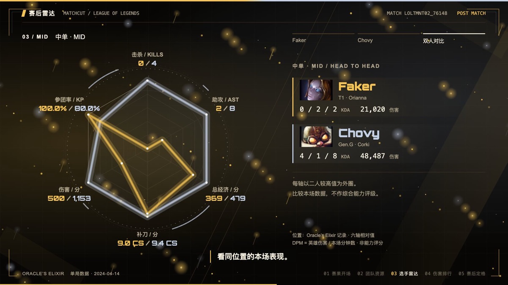

<p align="right">
  <a href="README.md">English</a> | <b>中文</b>
</p>

<h1 align="center">
  <a href="https://github.com/Cass-ette">
    
  </a>
</h1>

<p align="center">
  
</p>

<p align="center">
  <a href="https://github.com/Cass-ette">
    
  </a>
</p>

---

###  关于我

```yaml
name: Cass-ette
location: 中国
interests:
  - 写代码
  - 开源
  - 构建酷炫的东西
hobbies:
  - 把咖啡变成代码
  - 凌晨三点调 bug
  - 让一切跑起来
  - 打英雄联盟
current_focus: 创造更多有趣的项目
```

<br clear="both">

###  技术栈

| 方向 | 主要使用 | 相关技术 |
| :--- | :--- | :--- |
|  **后端与脚本** | <picture><source media="(prefers-color-scheme: dark)" srcset="https://skillicons.dev/icons?i=go%2Cpython&theme=dark" /><source media="(prefers-color-scheme: light)" srcset="https://skillicons.dev/icons?i=go%2Cpython&theme=light" /></picture><br />Go · Python | <picture><source media="(prefers-color-scheme: dark)" srcset="https://skillicons.dev/icons?i=java%2Cnodejs%2Cflask&theme=dark" /><source media="(prefers-color-scheme: light)" srcset="https://skillicons.dev/icons?i=java%2Cnodejs%2Cflask&theme=light" /></picture><br />Java · Node.js · Flask |
|  **前端与 Web** | <picture><source media="(prefers-color-scheme: dark)" srcset="https://skillicons.dev/icons?i=ts%2Creact&theme=dark" /><source media="(prefers-color-scheme: light)" srcset="https://skillicons.dev/icons?i=ts%2Creact&theme=light" /></picture><br />TypeScript · React | <picture><source media="(prefers-color-scheme: dark)" srcset="https://skillicons.dev/icons?i=vue%2Ctailwind%2Cjs%2Chtml%2Ccss&theme=dark" /><source media="(prefers-color-scheme: light)" srcset="https://skillicons.dev/icons?i=vue%2Ctailwind%2Cjs%2Chtml%2Ccss&theme=light" /></picture><br />Vue · Tailwind CSS · JavaScript · HTML / CSS |
|  **Apple 与原生客户端** | <picture><source media="(prefers-color-scheme: dark)" srcset="https://skillicons.dev/icons?i=swift%2Ccpp&theme=dark" /><source media="(prefers-color-scheme: light)" srcset="https://skillicons.dev/icons?i=swift%2Ccpp&theme=light" /></picture><br />Swift · C++ | <picture><source media="(prefers-color-scheme: dark)" srcset="https://skillicons.dev/icons?i=kotlin&theme=dark" /><source media="(prefers-color-scheme: light)" srcset="https://skillicons.dev/icons?i=kotlin&theme=light" /></picture><br />Kotlin |
|  **数据与部署** | <picture><source media="(prefers-color-scheme: dark)" srcset="https://skillicons.dev/icons?i=postgres%2Cdocker&theme=dark" /><source media="(prefers-color-scheme: light)" srcset="https://skillicons.dev/icons?i=postgres%2Cdocker&theme=light" /></picture><br />PostgreSQL · Docker | <picture><source media="(prefers-color-scheme: dark)" srcset="https://skillicons.dev/icons?i=mysql%2Credis%2Clinux&theme=dark" /><source media="(prefers-color-scheme: light)" srcset="https://skillicons.dev/icons?i=mysql%2Credis%2Clinux&theme=light" /></picture><br />MySQL · Redis · Linux |

<details>
  <summary>开发工具与创作软件</summary>

**开发工具**

<picture><source media="(prefers-color-scheme: dark)" srcset="https://skillicons.dev/icons?i=git%2Cgithub%2Cnpm%2Cpostman%2Cpycharm%2Cidea%2Cvscode&theme=dark" /><source media="(prefers-color-scheme: light)" srcset="https://skillicons.dev/icons?i=git%2Cgithub%2Cnpm%2Cpostman%2Cpycharm%2Cidea%2Cvscode&theme=light" /></picture>

**设计与 3D**

<picture><source media="(prefers-color-scheme: dark)" srcset="https://skillicons.dev/icons?i=ai%2Cps%2Cblender%2Cunreal&theme=dark" /><source media="(prefers-color-scheme: light)" srcset="https://skillicons.dev/icons?i=ai%2Cps%2Cblender%2Cunreal&theme=light" /></picture>

**使用平台**

<picture><source media="(prefers-color-scheme: dark)" srcset="https://skillicons.dev/icons?i=apple%2Cwindows&theme=dark" /><source media="(prefers-color-scheme: light)" srcset="https://skillicons.dev/icons?i=apple%2Cwindows&theme=light" /></picture>

</details>

---

###  贡献

<p align="center"><b>连续贡献统计</b></p>

<p align="center">
  <picture>
    <source media="(prefers-color-scheme: dark)" srcset="https://github-readme-streak-stats.herokuapp.com/?user=Cass-ette&hide_border=true&background=0D1117&border=30363D&stroke=30363D&ring=58A6FF&fire=58A6FF&currStreakNum=E6EDF3&sideNums=E6EDF3&currStreakLabel=58A6FF&sideLabels=8B949E&dates=8B949E" />
    <source media="(prefers-color-scheme: light)" srcset="https://github-readme-streak-stats.herokuapp.com/?user=Cass-ette&hide_border=true&background=FFFFFF&border=D0D7DE&stroke=D0D7DE&ring=0969DA&fire=0969DA&currStreakNum=1F2328&sideNums=1F2328&currStreakLabel=0969DA&sideLabels=57606A&dates=57606A" />
    
  </picture>
</p>

<p align="center"><b>贡献蛇</b></p>

<p align="center">
  <picture>
    <source media="(prefers-color-scheme: dark)" srcset="https://raw.githubusercontent.com/Cass-ette/Cass-ette/output/github-contribution-grid-snake-dark.svg" />
    <source media="(prefers-color-scheme: light)" srcset="https://raw.githubusercontent.com/Cass-ette/Cass-ette/output/github-contribution-grid-snake.svg" />
    
  </picture>
</p>

<p align="center"><b>3D 贡献日历</b></p>

<p align="center">
  <picture>
    <source media="(prefers-color-scheme: dark)" srcset="https://raw.githubusercontent.com/Cass-ette/Cass-ette/main/profile-3d-contrib/profile-blue-dark.svg" />
    <source media="(prefers-color-scheme: light)" srcset="https://raw.githubusercontent.com/Cass-ette/Cass-ette/main/profile-3d-contrib/profile-blue-light.svg" />
    
  </picture>
</p>

---

###  精选项目

####  电竞与媒体创作

**[Matchcut](https://github.com/Cass-ette/matchcut)** · `本地 Web`<br />
从比赛数据到赛后视频：选手对位、动态雷达图与视频导出，支持 Dota 2、英雄联盟和 CS。

<p align="center">
  <a href="https://github.com/Cass-ette/matchcut"></a>
</p>

- [fastlol](https://github.com/Cass-ette/fastlol) · `命令行` — 英雄联盟数据工具，支持 U.GG 数据抓取。
- [FFmpeg GUI Converter](https://github.com/Cass-ette/ffmpeg-gui-converter) · `桌面` — 基于 Go / Fyne 的视频、音频转码与封装工具。

####  生活与效率

<a href="https://github.com/Cass-ette/nearby"></a>

**[Nearby / 附近](https://github.com/Cass-ette/nearby)** · `iOS`<br />
别只路过，把今天留下来。用照片、心情和地点，慢慢拼出属于自己的记忆地图。<br />
<sub>SwiftUI · SwiftData · MapKit</sub>

<br clear="both" />

<a href="https://github.com/Cass-ette/coffer"></a>

**[Coffer](https://github.com/Cass-ette/coffer)** · `macOS`<br />
把密码、密钥、TOTP 验证码和敏感笔记，收进一个 Touch ID 一按即开的本地加密库。<br />
<sub>Swift · 本地存储 · 生物识别解锁</sub>

<br clear="both" />

- [Possible Forest / 可能森林](https://github.com/Cass-ette/possible-forest) · `iOS / iPadOS` — 用任务分支和宠物陪伴，设计弹性任务规划。
- [GoatMarkdown](https://github.com/Cass-ette/GoatMarkdown) · `macOS` — 支持多窗口、目录、搜索、书签与高亮的 Markdown 阅读器。

####  开发工具与语言

**[Gwen](https://github.com/Cass-ette/gwen-lang)** · `命令行`<br />
面向后端与自动化的语言，从解释器、类型检查器，一直做到 C 编译后端。

- [algosketch](https://github.com/Cass-ette/algosketch) · `命令行` — 把 Python、Java、C++、Go 的算法代码转为伪代码与中英文解释。
- [DevMacpp](https://github.com/Cass-ette/DevMacpp) · `macOS` — 面向算法练习与竞赛编程的 C++ 编辑器。

####  网络与自托管

**[NetKitX](https://github.com/Cass-ette/NetKitX)** · `Web / 服务端`<br />
把插件管理、实时任务与网络拓扑整合到一起的网络安全工具平台。

- [ProxyCat](https://github.com/Cass-ette/ProxyCat) · `macOS` — 菜单栏代理管理，支持订阅、系统代理状态与连通性诊断。
- [MAA Remoter](https://github.com/Cass-ette/ArknightsMaaRemoter-) · `Web / 服务端` — 自托管的 MAA 远程控制后端与面板，支持任务下发、状态与截图。

####  金融与数据分析

**[Treasure](https://github.com/Cass-ette/treasure)** · `Web`<br />
多账户基金持仓管理、净值追踪与收益分析，看清资金分布和收益来源。

- [ETF CLI](https://github.com/Cass-ette/etf-cli) · `命令行` — 查询 A 股 ETF 与场外基金行情，管理配对与关注列表。
- [QuanTrader](https://github.com/Cass-ette/QuanTrader) · `Python` — ETH/USDT 趋势跟踪与波动率过滤策略实验。

<details>
  <summary>更多项目</summary>

**工具与实验**：[github-real-stars](https://github.com/Cass-ette/github-real-stars) · [mobile-vscode](https://github.com/Cass-ette/mobile-vscode) · [DualPaper](https://github.com/Cass-ette/DualPaper) · [NetKitX Plugins](https://github.com/Cass-ette/NetKitX-Plugins) · [Homelab Monitor](https://github.com/Cass-ette/homelab-monitor) · [Schedule to Calendar](https://github.com/Cass-ette/schedule-to-calendar) · [Tried Solutions](https://github.com/Cass-ette/Tried-Solutions)

**金融**：[FortuneTale](https://github.com/Cass-ette/FortuneTale-)

**Web**：[Blog](https://github.com/Cass-ette/blog.github.io-) · [Flask API Review](https://github.com/Cass-ette/flask-api-review) · [Flask Device API](https://github.com/Cass-ette/flask_device_api) · [ABDOJ](https://github.com/Cass-ette/abdoj)

**游戏**：[BetterGI Remoter](https://github.com/Cass-ette/BetterGIRemoter) · [League of Tops](https://github.com/Cass-ette/league-of-tops)

[浏览全部仓库](https://github.com/Cass-ette?tab=repositories)

</details>

---

###  联系我

<p align="center">
  <a href="mailto:1804534439@qq.com">
    
  </a>
</p>

<p align="center">
  
</p>

<p align="center">
  <i>"给我一个S冠！！"</i>
</p>

<p align="center">
  
</p>
